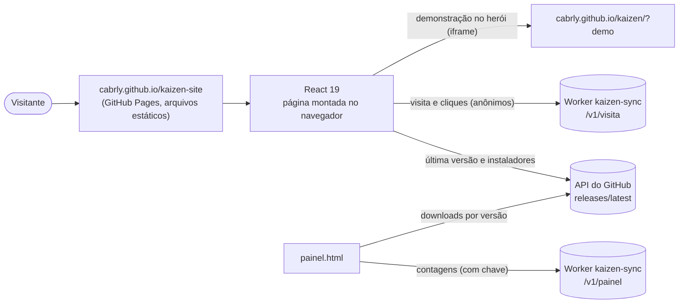
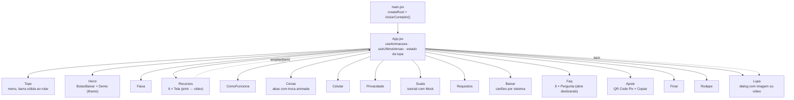
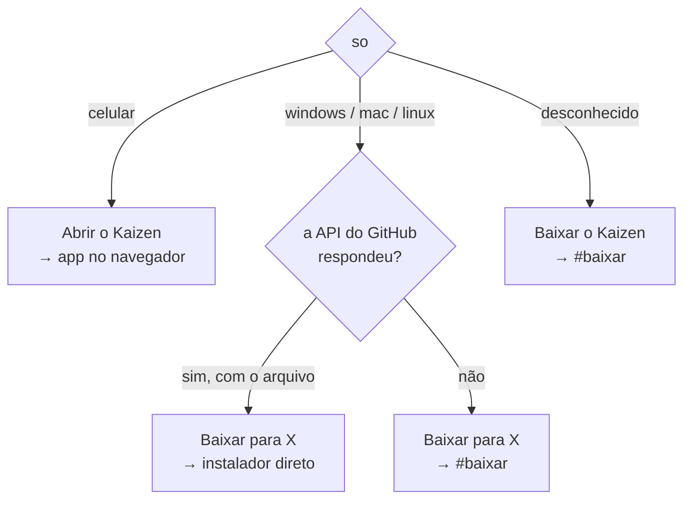
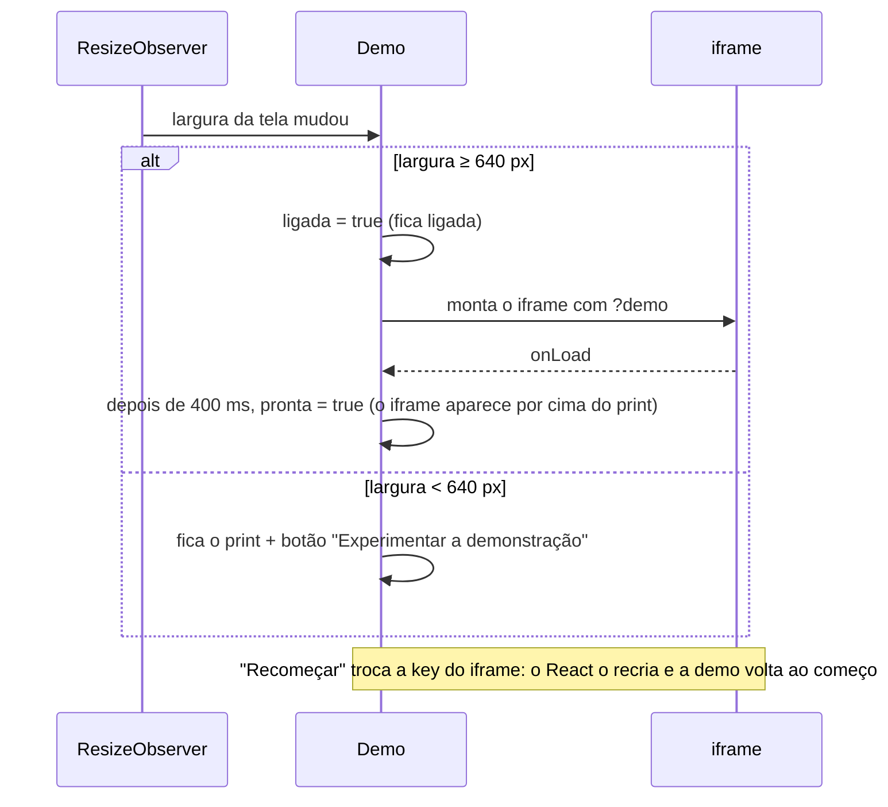
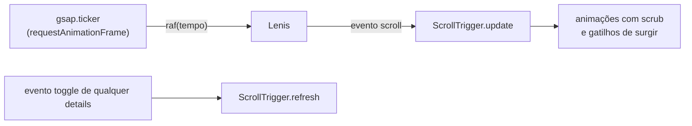
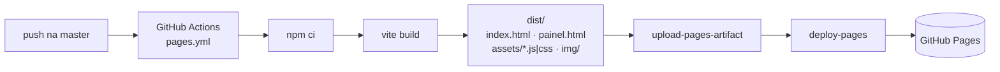

# Arquitetura do site

Este documento explica como as peças do site se ligam. Os diagramas usam Mermaid, que o
GitHub desenha sozinho.

## Visão geral

O site é uma página única (SPA sem rotas) montada pelo React. Ela não tem servidor
próprio: tudo roda no navegador e conversa com dois serviços externos.

Se a API do GitHub não responder (offline ou limite de pedidos), os links de download
continuam indo para a página de versões. Se o Worker não responder, a contagem é perdida
em silêncio: contar nunca atrapalha o site.

## Árvore de componentes

As seções só de conteúdo (`Faixa`, `ComoFunciona`, `Celular`, `Privacidade`, `SuaIa`,
`Requisitos`, `Final`, `Rodape`) ficam juntas em `componentes/Secoes.jsx`. Cada peça com
estado ou interação tem o próprio arquivo.

## Estado e dados

Quase tudo é estado local. Só dois dados atravessam componentes:

| Dado | Dono | Quem usa | Como chega |
|---|---|---|---|
| Última versão do app (`versao`) | `App`, via `useUltimaVersao()` | `Heroi` (botão principal) e `Baixar` | prop |
| Item ampliado (`ampliado`) | `App` | `Recursos` escreve, `Lupa` lê | `ampliar` (setter) e `item` (prop) |

O sistema do visitante (`so`) é calculado uma vez, quando o módulo `download.js` carrega:
o user agent não muda durante a visita.

### Escolha do link de download

Os cartões da seção Baixar seguem a mesma lógica com `arquivo(versao, fim)`. Sem
resposta, apontam para `releases/latest`.

## Demonstração no herói

O app de verdade roda num `<iframe>` dentro da janela desenhada. Ele é desenhado com
1280 px de largura e encolhido com `transform: scale()` para caber, então fica igual ao
print que está por baixo.

## Animação e rolagem

O Lenis faz a rolagem suave, mas quem dá o ritmo é o relógio do GSAP. Assim o
ScrollTrigger lê a posição de rolagem no mesmo quadro em que ela muda, e nada treme.

- Tudo isso está em `src/movimento.js`. Os componentes importam `gsap`, `useGSAP`,
  `lenis` e `calmo` de lá, nunca direto das bibliotecas.
- `calmo` é `true` quando o sistema pede menos movimento. Nesse caso o Lenis nem é criado
  (`lenis` fica `null`), e cada animação começa com `if (calmo) return`.
- As animações de rolagem ficam todas em `useAnimacoes`, no `App.jsx`. As que respondem a
  clique ficam no componente dono (`Cenas`, `Faq`, `Lupa`), dentro de `contextSafe`, para
  o `useGSAP` desfazê-las se o componente sair da tela.
- Abrir ou fechar um `
` muda a altura da página. Um ouvinte de `toggle` (em
  captura) chama `ScrollTrigger.refresh()` para recalcular onde cada gatilho fica.

O catálogo de cada animação está em [ANIMACOES.md](ANIMACOES.md).

## Build e publicação

O build sai em arquivos separados, cada um com hash no nome (cache longo no navegador):

| Arquivo | O que tem | gzip (aprox.) |
|---|---|---|
| `react-*.js` | React e React DOM | 69 kB |
| `animacao-*.js` | GSAP, ScrollTrigger, @gsap/react e Lenis | 51 kB |
| `index-*.js` | o código do site | 17 kB |
| `qrcode-*.js` | gerador de QR Code, carregado sob demanda | 8 kB |
| `painel-*.js` | o painel, só em `painel.html` | 4 kB |
| `index-*.css` | todo o visual | 7 kB |

Caminhos relativos (`base: "./"`) permitem servir o mesmo `dist/` em qualquer subpasta.
Os arquivos de `public/` são copiados sem mudança. Por isso o código usa `img/...`
(relativo à página) e o CSS usa `/img/...`, que o Vite reescreve.

## Contagem anônima

`contador.js` conta uma visita por sessão (marcada em `sessionStorage`), a origem dela
(só o nome do site, como WhatsApp ou Google) e os cliques em baixar, abrir no navegador e
mexer na demonstração. Não usa cookie nem identificador. Em `localhost` não conta nada.

O envio usa `navigator.sendBeacon` (não segura a navegação). Sem ele, usa `fetch` com
`keepalive`. Os cliques são lidos por um único ouvinte no `document`, que reconhece os
botões pelos atributos `data-so` e `data-baixar-principal`. Por isso os componentes
mantêm esses atributos.
