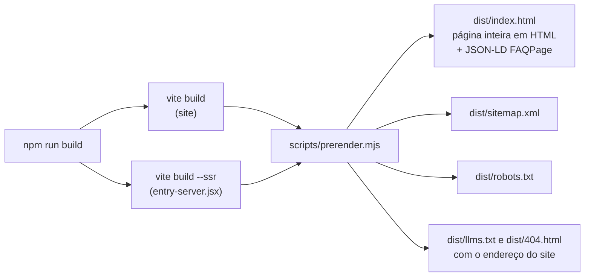

# SEO, assistentes de IA e preview de link

O objetivo é ser encontrado pelo Google, ser citado certo pelo ChatGPT, Claude, Gemini e
Perplexity, e aparecer bonito quando alguém manda o link no WhatsApp, LinkedIn ou Discord. O
padrão é o mesmo do portfólio [bernardes.dev](https://bernardes.dev).

## O que está configurado

| Peça | Onde | Para quê |
|---|---|---|
| HTML pré-renderizado | `scripts/prerender.mjs` | O texto inteiro já vem no HTML. Robôs que não rodam JavaScript (a maioria dos de IA, e o primeiro passe do Google) leem tudo. |
| `<title>` e `description` | `index.html` | O que aparece no resultado da busca. |
| `canonical` | `index.html` | Diz qual é o endereço oficial (evita duplicata com `?utm_...`). |
| Open Graph e Twitter Card | `index.html` | Título, descrição e imagem do preview de link. |
| `og.jpg` (1200×630, 99 kB) | `public/og.jpg` | A imagem do preview. Fica abaixo de 300 kB, o limite do WhatsApp. |
| JSON-LD `WebSite` + `SoftwareApplication` | `index.html` | Diz às máquinas que isto é um app grátis, pra quais sistemas, onde baixar, o que faz e quem fez. |
| JSON-LD `FAQPage` | gerado no build | As 9 perguntas do site como dados estruturados, a partir de `src/conteudo.jsx`. |
| `llms.txt` | `public/llms.txt` | Resumo do app em Markdown para assistentes de IA ([padrão llms.txt](https://llmstxt.org)). O `<head>` aponta pra ele com `rel="alternate" type="text/markdown"`. |
| `sitemap.xml` | gerado no build | Lista a página pra indexação, com a data do build. |
| `robots.txt` | gerado no build | Libera tudo, menos o painel privado. |
| `404.html` | `public/404.html` | Página de erro no visual do site, com `noindex`. |

O endereço do site vem da variável `VITE_SITE_URL` (padrão
`https://cabrly.github.io/kaizen-site`). O Vite troca o `%VITE_SITE_URL%` do `index.html`, e o
pré-render troca o `%SITE_URL%` e o `%SITE_PATH%` do `llms.txt` e da `404.html`. Pra mudar de
domínio, defina a variável no build (no workflow, em `env:`) e mais nada.

## Depois de publicar (precisa da conta do dono)

Estas etapas não dá pra automatizar daqui, porque pedem login no Google e no Bing:

1. **Google Search Console** (https://search.google.com/search-console): adicione a
   propriedade `https://cabrly.github.io/kaizen-site/`, confirme pela tag HTML (uma
   `<meta name="google-site-verification">` no `index.html`) e envie o `sitemap.xml`.
2. **Bing Webmaster Tools** (https://www.bing.com/webmasters): importe do Search Console. O Bing
   alimenta o ChatGPT com busca e o Copilot.
3. Peça a indexação da página em "Inspeção de URL" no Search Console.

> **Atenção ao `robots.txt` no GitHub Pages.** Os robôs só leem o `robots.txt` da raiz do
> domínio (`cabrly.github.io/robots.txt`), que pertence a outro repositório. O nosso
> `robots.txt` passa a valer quando o site tiver domínio próprio. Até lá, o sitemap entra pelo
> Search Console e o painel continua fora dos buscadores pela `<meta name="robots"
> content="noindex">` dele.

## Como testar

| O quê | Ferramenta |
|---|---|
| Preview de link (WhatsApp, LinkedIn, X) | https://www.opengraph.xyz ou o [Post Inspector do LinkedIn](https://www.linkedin.com/post-inspector/) |
| Dados estruturados | https://search.google.com/test/rich-results e https://validator.schema.org |
| O que um robô sem JavaScript vê | `curl -s https://cabrly.github.io/kaizen-site/ \| less` (o texto todo tem que estar ali) |
| Lighthouse (SEO, acessibilidade, desempenho) | DevTools do Chrome → Lighthouse |

O WhatsApp guarda o preview em cache. Depois de trocar a imagem, mande o link com um parâmetro
novo (`?v=2`) pra ver a versão atual.

## Refazer a imagem de preview

A fonte é `scripts/og-card.html`, uma página de 1200×630 que usa as imagens de `public/`.

1. Edite o texto ou o layout em `scripts/og-card.html`.
2. Rode `npm run dev` e abra http://localhost:5173/scripts/og-card.html no Chrome, com a tela em
   1200×630 (DevTools → modo dispositivo → largura 1200, altura 630).
3. Tire o print da área (DevTools → `Ctrl+Shift+P` → "Capture screenshot") e salve como JPEG
   com qualidade em torno de 85 em `public/og.jpg`. Mantenha abaixo de 300 kB.

## Escrevendo pra ser citado por IA

Assistentes de IA citam o que conseguem ler e resumir com segurança. Por isso:

- **Fatos concretos** ajudam mais que adjetivos: "plano de 12 sessões em cerca de 45 s numa
  placa de 6 GB" é citável; "rápido e poderoso" não é.
- **Mantenha o `llms.txt` em dia** quando um recurso mudar. Ele é a fonte que a IA lê primeiro.
- **Uma pergunta por intenção** no FAQ, com a resposta completa na primeira frase.
